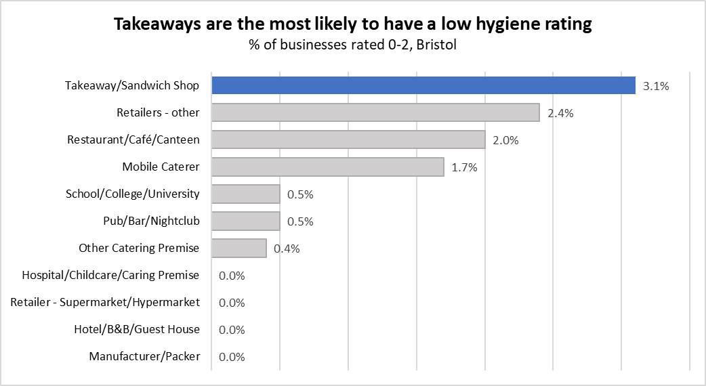

# Bristol Food Hygiene Rating Report

## What this does
A beginner SQL project looking at which types of food business in Bristol are most likely to have low food hygiene ratings. I used SQL Server Management Studio to clean and summarise the data, then Excel to chart the results. The question was "Which types of food business in Bristol are most likely to have low hygiene ratings?".

## Data
Public food hygiene rating data from https://ratings.food.gov.uk/open-data (Local Authority: Bristol, downloaded 1 November 2026).
Contains public sector information licensed under the Open Government Licence v3.0.

 ## Files
   - 'data/FHRS855en-GB.csv' – raw data
   - 'FHR_project.sql' – queries (import the CSV into SQL Server as a table called 'hygiene_ratings')
   - 'results.xlsx' – query results and chart
   - 'chart.png' – final chart

## What I found
  
- Takeaways and sandwich shops are the most likely to have a low hygiene rating: 3.1% (12 of 387) were rated 0-2, about double the overall rate of 1.6% (60 of 3,730).
- They also had the lowest average rating of any business type (4.41 out of 5). Hospitals, childcare and caring premises had the highest (4.93).
- "Other" retailers (2.4%) and restaurants/cafés/canteens (2.0%) also had above-average shares of low ratings.
- Four business types had no low-rated businesses at all: hospitals/childcare/caring premises, supermarkets, hotels/B&Bs and manufacturers/packers.
- Overall, low ratings are rare in Bristol: most businesses score 4 or 5.

## What went wrong
- 'RatingValue' is stored as text and includes non-numeric values (Exempt, AwaitingInspection, AwaitingPublication), so I had to filter these out and convert the ratings to numbers before calculating averages.

## What I would do next
- Compare areas of Bristol by postcode to see whether low ratings cluster in particular areas.
- Rebuild the chart as an interactive dashboard in Power BI.
